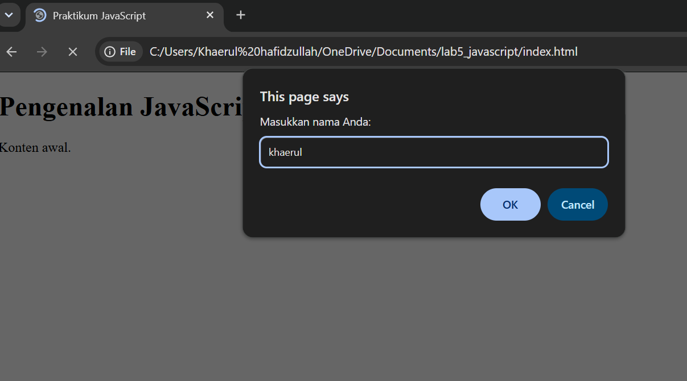
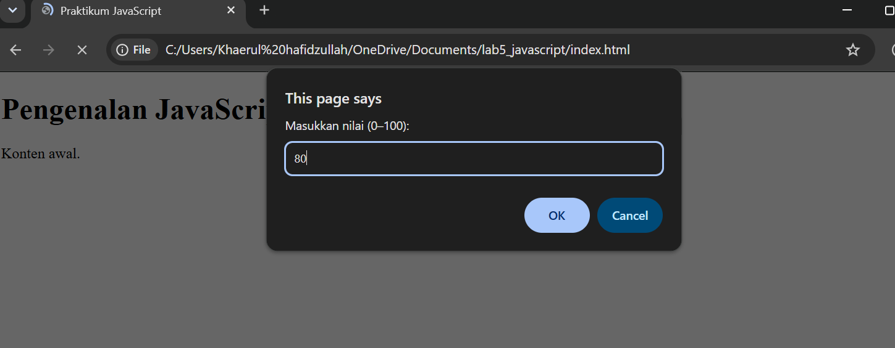
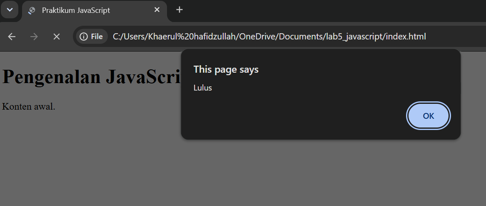
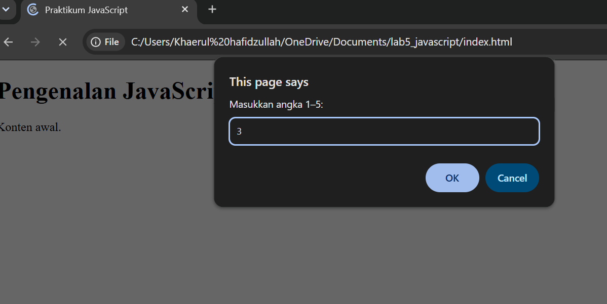
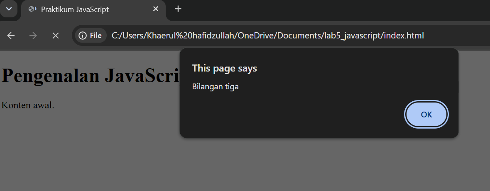
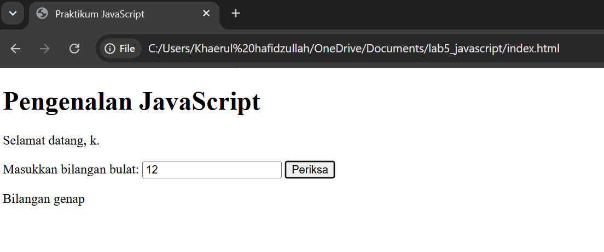
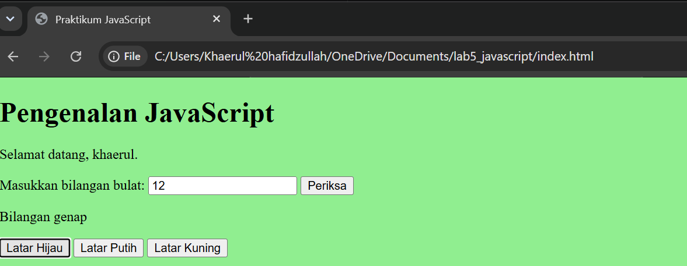
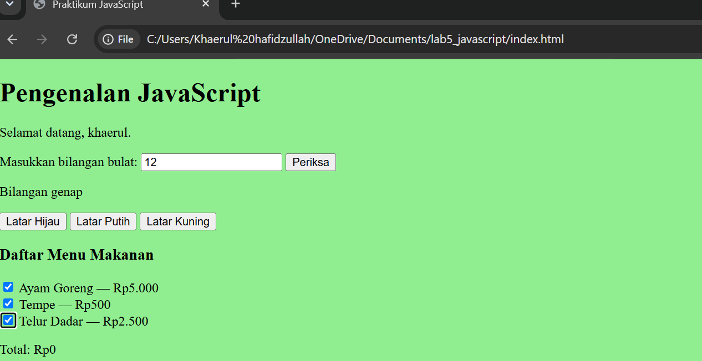

Berikut adalah jawaban untuk **Bagian H (Pertanyaan dan Tugas)** berdasarkan modul praktikum:

---

### 1. Jelaskan perbedaan `console.log()`, `alert()`, `prompt()`, dan `textContent`/`innerHTML`.

* **`console.log()`**: Digunakan untuk menampilkan pesan atau hasil debugging ke *console* pada browser, yang biasanya hanya dilihat oleh pengembang (*developer*).
* **`alert()`**: Digunakan untuk memunculkan jendela dialog pop-up kecil di browser yang berisi pesan peringatan/informasi dengan tombol "OK".
* **`prompt()`**: Digunakan untuk memunculkan jendela dialog pop-up yang meminta masukan (*input*) teks dari pengguna.
* **`textContent`**: Properti DOM yang digunakan untuk mengambil atau mengubah teks di dalam suatu elemen HTML secara aman (mengabaikan tag HTML).
* **`innerHTML`**: Properti DOM yang digunakan untuk mengambil atau mengubah konten di dalam elemen HTML, di mana string yang dimasukkan dapat mengandung tag HTML (seperti `<b>`, `<br>`, dll.).

---

### 2. Apa perbedaan `let` dan `const`? Berikan contoh.

* **`const`**: Digunakan untuk mendeklarasikan variabel yang nilainya **tetap** dan tidak dapat diubah kembali (*reassigned*) setelah dideklarasikan.
* **`let`**: Digunakan untuk mendeklarasikan variabel yang nilainya **dapat diubah** atau ditetapkan ulang di kemudian hari.

**Contoh:**

```javascript
const pi = 3.14; // Nilai pi tidak akan berubah
let skor = 0;    // Skor bisa bertambah seiring waktu
skor = 10;       // Valid

```

---

### 3. Apa perbedaan operator `==` dan `===`?

* **`==` (Equal to)**: Membandingkan kesetaraan nilai **tanpa** memperhatikan tipe datanya (melakukan *type coercion* jika tipe data berbeda, misal `"5" == 5` bernilai `true`).
* **`===` (Equal value and equal type)**: Membandingkan kesetaraan nilai **sekaligus** tipe datanya (jika tipe data berbeda, maka langsung bernilai `false`, misal `"5" === 5` bernilai `false`).

---

### 4. Jelaskan fungsi `if–else` dan `switch`. Kapan masing-masing dapat digunakan?

* **`if–else`**: Struktur percabangan untuk menguji kondisi logis yang menghasilkan nilai boolean (`true` atau `false`). Cocok digunakan ketika kondisi melibatkan rentang angka, operator perbandingan (`>`, `<`, `>=`, `<=`), atau kondisi logika yang kompleks (`&&`, `||`).
* **`switch`**: Struktur percabangan untuk memilih satu dari berbagai blok kode berdasarkan kecocokan nilai tunggal. Cocok digunakan ketika Anda memiliki banyak pilihan tetap/pasti (seperti pilihan menu 1, 2, 3, atau pemilihan hari/bulan).

---

### 5. Apa fungsi parameter dan return dalam function?

* **Parameter**: Variabel penampung data masukan (*input*) yang dikirimkan ke dalam sebuah fungsi saat fungsi tersebut dipanggil.
* **`return`**: Perintah yang digunakan untuk menghentikan fungsi sekaligus mengembalikan hasil akhir atau nilai keluaran (*output*) dari proses di dalam fungsi tersebut ke bagian kode yang memanggilnya.

---

### 6. Bagaimana JavaScript memilih elemen HTML menggunakan `document.getElementById()`?

Fungsi `document.getElementById("namaId")` bekerja dengan cara mencari dan menargetkan elemen unik di dalam dokumen HTML yang memiliki atribut `id` yang persis sama dengan string argumen yang diberikan. Setelah elemen ditemukan, JavaScript dapat mengambil atau memodifikasi konten, atribut, maupun gaya CSS dari elemen tersebut.

---

### 7. Buat script untuk memvalidasi form agar nama tidak kosong dan nilai berada pada rentang 0–100.

Berikut adalah contoh fungsi JavaScript sederhana untuk melakukan validasi tersebut:

```javascript
function validasiForm() {
    const nama = document.getElementById("nama").value;
    const inputNilai = document.getElementById("nilai").value;
    const nilai = Number(inputNilai);

    // Validasi nama kosong
    if (nama.trim() === "") {
        alert("Nama tidak boleh kosong!");
        return false;
    }

    // Validasi nilai kosong atau di luar rentang 0-100
    if (inputNilai.trim() === "" || isNaN(nilai) || nilai < 0 || nilai > 100) {
        alert("Nilai harus berupa angka pada rentang 0 sampai 100!");
        return false;
    }

    alert("Validasi berhasil!");
    return true;
}

```

Berikut adalah isi file **README.md** yang disusun secara lengkap dan profesional sesuai dengan instruksi pada **Bagian I (Laporan Praktikum dan Pengumpulan)** dari [Modul Praktikum 5: JavaScript Dasar](https://drive.google.com/file/d/1EUsFujKD5rsS3B7LEJ3M2l0gWltILDVA/preview):

---

# Laporan Praktikum 5: JavaScript Dasar dan Manipulasi HTML

Repitori ini dibuat untuk memenuhi tugas **Praktikum 5: JavaScript Dasar dan Manipulasi HTML** pada mata kuliah **Pemrograman Web**.

---

## 📋 Tujuan Praktikum

1. Memahami sintaks dasar JavaScript dan cara menyisipkan JavaScript pada halaman HTML.
2. Menggunakan variabel, tipe data, operator, percabangan, perulangan, dan fungsi (*function*).
3. Menampilkan informasi melalui *console*, *alert*, *prompt*, serta elemen HTML.
4. Memanipulasi konten dan gaya elemen HTML menggunakan JavaScript DOM.
5. Membuat interaksi sederhana pada form serta menerapkan validasi input.
6. Mendokumentasikan seluruh rangkaian latihan dan hasil pengujiannya.

---

## 🛠️ Langkah Kerja Praktikum

1. **Persiapan Folder Kerja:** Membuat direktori kerja baru dengan nama `Lab5_JavaScript` dan mempersiapkan berkas `index.html` serta `script.js`.
2. **Penyisipan Skrip:** Menghubungkan file JavaScript eksternal ke dalam dokumen HTML menggunakan tag `<script src="script.js"></script>`.
3. **Implementasi Latihan (Latihan 1 – 8):**
* **Latihan 1:** Menampilkan output ke halaman web dan *Console*.
* **Latihan 2:** Menggunakan kotak dialog `alert()` dan `prompt()`.
* **Latihan 3:** Membuat fungsi (*function*) dengan parameter dan melakukan operasi aritmetika dasar.
* **Latihan 4 & 5:** Menerapkan seleksi kondisi menggunakan `if–else` dan `switch`.
* **Latihan 6:** Membuat interaksi form untuk memeriksa bilangan genap atau ganjil.
* **Latihan 7:** Mengubah gaya dan warna latar belakang halaman menggunakan fungsi berparameter.
* **Latihan 8:** Menggunakan DOM dan *event listener* untuk menghitung total harga menu makanan dari elemen *checkbox* secara dinamis.


4. **Mini Project:** Mengembangkan Kalkulator Nilai Mahasiswa yang dilengkapi form input, perhitungan bobot (Tugas, UTS, UAS), penentuan predikat, status kelulusan, serta validasi nilai pada rentang 0–100.

---

## 🚀 Cara Menjalankan Program

1. Clone atau unduh repositori ini ke komputer lokal Anda.
2. Buka folder proyek menggunakan teks editor (misalnya **Visual Studio Code**).
3. Buka file `index.html` menggunakan browser modern (Google Chrome, Firefox, dll.).
4. Tekan `F12` atau klik kanan lalu pilih **Inspect / Periksa** dan navigasikan ke tab **Console** untuk melihat hasil *output* skrip.

---

## 📸 Hasil Pengujian Latihan (Screenshot)

*(Letakkan *screenshot* hasil eksekusi dari masing-masing latihan dan mini project pada bagian ini untuk melengkapi dokumentasi laporan praktikum).*

* **Latihan 1 – 5 (Output, Dialog, Aritmetika, dan Percabangan):**






* **Latihan 6 – 8 (Form Interaktif, Warna Ltar, dan DOM Checkbox):**





---

## 👨‍💻 Identitas Praktikan

* **Nama:** Khaerul Hafidzullah
* **Program Studi:** Teknik Informatika
* **Mata Kuliah:** Pemrograman Web (OBE)